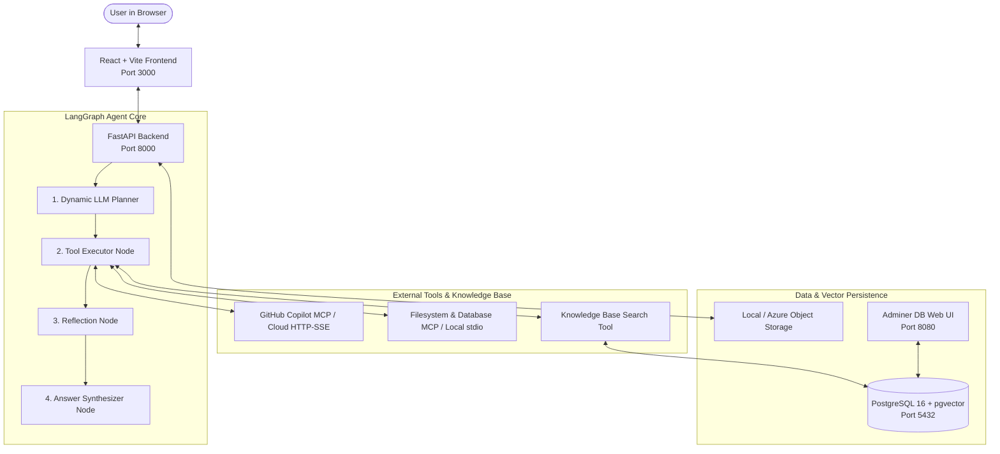

# Autonomous Agentic ChatBot

> A production-grade, full-stack Autonomous Agentic AI system powered by **LangGraph**, **Model Context Protocol (MCP)**, and **Advanced Enterprise RAG** (`pgvector` + BM25 Hybrid Search).

---

## 🌟 Overview

**Autonomous Agentic ChatBot** is not a simple question-and-answer chatbot. It is a full **autonomous agent** equipped with a reasoning loop, long-term memory, document ingestion capabilities, and external tool execution.

### Key Capabilities:
- 🧠 **Autonomous Planning & Reasoning Loop**: Powered by LangGraph StateGraph (`Plan` $\rightarrow$ `Tool Execution` $\rightarrow$ `Reflection` $\rightarrow$ `Synthesis`).
- 🔌 **Model Context Protocol (MCP) Gateway**: Connects to both local `stdio` subprocesses and remote cloud `HTTP/SSE` tools (including **GitHub Copilot MCP**, **Database MCP**, and **Filesystem MCP**).
- 📚 **Advanced Enterprise RAG**: Ingests Word (`.docx`), PDF, and Markdown files. Uses **`gemini-embedding-2`** dense vectors, PostgreSQL `pgvector` HNSW index, BM25 full-text lexical search (`tsvector`), and Reciprocal Rank Fusion (RRF).
- 🎨 **Real-Time Generative UI**: Built with React, Vite, and TailwindCSS. Features real-time SSE token streaming, expandable thought step traces, tool execution badges with millisecond latencies, and interactive source citations.
- 🗄️ **Integrated Database Web UI**: Built-in browser database manager (Adminer) to inspect tables, chunk records, and raw vector embeddings.

---

## 🏗️ Architecture



---

## 🚀 Quick Access Points

Once running, all services are accessible via your browser:

| Service | URL | Credentials / Notes |
| :--- | :--- | :--- |
| **Agent Chat & UI** | [http://localhost:3000](http://localhost:3000) | Main user interface |
| **FastAPI Swagger Docs** | [http://localhost:8000/docs](http://localhost:8000/docs) | Interactive API exploration |
| **Database Web UI (Adminer)** | [http://localhost:8080](http://localhost:8080) | **System:** PostgreSQL \| **Server:** `db` \| **User/Pass:** `postgres` / `postgres` \| **DB:** `agent_chatbot` |
| **PostgreSQL Port** | `localhost:5432` | Accessible by DBeaver, TablePlus, pgAdmin |

---

## 📋 Prerequisites

Ensure you have the following installed on your machine:
- **[Docker Desktop](https://www.docker.com/products/docker-desktop/)** (v24.0+)
- **API Key**: A **Google Gemini API Key** (or **OpenAI API Key**)
- *(Optional for GitHub MCP)*: A **GitHub Personal Access Token (PAT)**

---

## ⚡ 1-Click Setup & Launch (Recommended)

### 1. Clone the Repository
```bash
git clone https://github.com/Thanveer1086/AI-Agent-ChatBot.git
cd AI-Agent-ChatBot
```

### 2. Configure Environment Variables (`.env`)
Create or edit your `.env` file in the root directory:
```env
# ==============================================================================
# LLM Provider Configuration (Gemini or OpenAI)
# ==============================================================================
API_USED=gemini
GEMINI_API_KEY=your_gemini_api_key_here
GEMINI_MODEL=gemini-3.5-flash

# Optional: OpenAI
# API_USED=openai
# OPENAI_API_KEY=your_openai_key_here
# OPENAI_MODEL=gpt-4o

# ==============================================================================
# Vector Embeddings
# ==============================================================================
EMBEDDING_PROVIDER=gemini
EMBEDDING_MODEL=gemini-embedding-2
EXPECTED_EMBEDDING_DIM=1536

# ==============================================================================
# Database & Storage
# ==============================================================================
DATABASE_URL=postgresql://postgres:postgres@db:5432/agent_chatbot
DEV_STORAGE_LOCAL_PATH=./storage/blobs

# ==============================================================================
# Security & Agent Limits
# ==============================================================================
DEV_AUTH_BYPASS=true
JWT_SECRET=super-secret-key-change-in-production
MAX_AGENT_ITERATIONS=5
TOOL_TIMEOUT_SECONDS=15
```

### 3. Start the Docker Stack
```powershell
docker compose up -d
```
Docker will start all 4 services:
1. `agent_chatbot_db` (Postgres 16 + pgvector)
2. `agent_chatbot_backend` (FastAPI + LangGraph)
3. `agent_chatbot_frontend` (Vite React UI)
4. `agent_chatbot_adminer` (Database Web GUI)

---

## 🧪 How to Test Your Agentic Chatbot

Open [http://localhost:3000](http://localhost:3000) and try these tests:

### Test 1: Cloud Tool Calling via GitHub MCP
Ask:
```text
In my github how many repo are there please check?
```
or
```text
List all my repository names
```
- **What happens:** The agent uses `gemini-3.5-flash` to evaluate the 50 available tools, selects `mcp_github-Ai-Chief-Of-Staff_get_me` or `search_repositories`, calls GitHub's API across the cloud, and returns your real GitHub repositories with live links.

### Test 2: Document RAG with Exact Citations
1. Click the **"Knowledge Studio"** tab at the top.
2. Upload any Word document (`.docx`), PDF, or text file.
3. Switch back to **"Agent Chat"** and ask:
   ```text
   Please give the overall explanation about netspectionve sync meeting 02-11
   ```
- **What happens:** The agent fuzzy-matches the title against active database records, calls `knowledge_base_search`, retrieves top semantic chunks via `gemini-embedding-2` vector similarity, and synthesizes a structured summary with clickable citation badges.

### Test 3: System Database Inspection
Ask:
```text
Show me the database system metrics
```
- **What happens:** The agent calls `mcp_internal_database_get_system_metrics`, inspects PostgreSQL, and displays indexed chunk counts, vector dimensions, and database engine status.

---

## 🔌 Adding New MCP Servers

All Model Context Protocol servers are configured in [`mcp_config.json`](./mcp_config.json). The system supports both **local command-line tools** and **cloud HTTP/SSE endpoints**:

### Local Command Server (`stdio`):
```json
"internal_database": {
  "transport": "stdio",
  "command": "python",
  "args": ["-m", "mcp_servers.database.server"],
  "enabled": true
}
```

### Remote Cloud Server (`HTTP / SSE`):
```json
"github-Ai-Chief-Of-Staff": {
  "url": "https://api.githubcopilot.com/mcp/",
  "headers": {
    "Authorization": "Bearer ${GITHUB_PAT}"
  }
}
```

### Hot-Reload Tools Without Docker Restart:
1. Open [http://localhost:3000](http://localhost:3000) $\rightarrow$ click the **"MCP Inspector"** tab.
2. Click **"Reload Tool Catalog"**. The new tools appear instantly in your catalog.

---

## 🔄 How to Restart Docker When You Make Changes

Whenever you edit files in your project, choose the right restart command based on what you changed:

| What Did You Change? | What to Do / Command | Why? |
| :--- | :--- | :--- |
| **Changed `.env`** (API keys, model name, settings) | `docker compose up -d backend` | Docker injects updated `.env` values when recreating the container. Takes ~2 seconds. |
| **Edited Python Code** (`backend/src/...`) | **No restart needed!** *(Auto hot-reloads)*<br>Or: `docker compose restart backend` | Source files are live-mounted. Uvicorn detects file edits and reloads instantly. |
| **Edited Frontend Code** (`frontend/src/...`) | **No restart needed!** *(Vite HMR)*<br>Or refresh your browser | Vite uses Hot Module Replacement to update changes in real time. |
| **Installed new Python package** (`pyproject.toml` or `Dockerfile`) | `docker compose up -d --build backend` | Tells Docker to rebuild the container image with the new dependencies. |
| **Edited `mcp_config.json`** (Added new MCP server) | Go to **MCP Inspector** in UI & click **"Reload Tool Catalog"**<br>Or: `docker compose restart backend` | MCP manager re-reads the config file and queries tool endpoints. |
| **Edited `docker-compose.yml`** (Ports, volumes, or new service) | `docker compose up -d` | Docker will apply configuration changes without touching unmodified containers. |
| **General Quick Restart** (Restart all containers) | `docker compose restart` | Gracefully stops and restarts all 4 containers without losing data. |
| **Full Clean Reset** (Stop everything and bring it back up) | `docker compose down`<br>`docker compose up -d` | Stops all containers and brings them back fresh with persistent database intact. |

---

## 🛠️ Management & Useful Commands

### 1. View Live Backend Logs (Crucial for Debugging)
```powershell
docker compose logs -f backend
```
Press `Ctrl + C` anytime to exit the log view.

### 2. View All Running Containers & Status
```powershell
docker compose ps
# or
docker ps
```

### 3. Check Database Health & Logs
```powershell
docker compose logs -f db
```

### 4. Stop the Entire Application
```powershell
docker compose down
```

---

## 📂 Project Structure

```text
AI-Agent-ChatBot/
├── backend/                        # FastAPI Backend & Agent Service
│   ├── src/
│   │   ├── api/                    # SSE Streaming, Files, MCP, and Admin Routes
│   │   ├── core/
│   │   │   ├── agent/              # LangGraph Workflow, Planner, Executor, Nodes
│   │   │   ├── db/                 # Database Session, Schema (schema.sql), Blobs
│   │   │   ├── mcp/                # MCP Client Manager, Adapters, Executor
│   │   │   ├── rag/                # Embeddings, Hybrid Search, Doc Parser (DOCX/PDF)
│   │   │   └── security/           # JWT Authentication, DEV_AUTH_BYPASS
│   │   └── config.py               # Pydantic Settings & Environment Validator
│   └── Dockerfile
├── frontend/                       # Vite + React SPA
│   ├── src/
│   │   ├── components/
│   │   │   ├── chat/               # Chat Container, Reasoning Trace, Citations
│   │   │   └── admin/              # Knowledge Studio & MCP Tool Inspector
│   └── Dockerfile
├── mcp_servers/                    # Local Reference MCP Servers (Database, Filesystem)
├── storage/                        # Persistent Document & Blob Storage
├── docker-compose.yml              # Multi-container orchestration (DB, Backend, Frontend, Adminer)
├── mcp_config.json                 # Model Context Protocol Catalog
├── .env                            # Active environment configuration
└── README.md                       # Project documentation
```

---

## 🔒 Security & Guardrails

- **Zero-Storage Secrets**: Tokens are stored strictly in `.env` and kept in `.gitignore`.
- **Dual-Mode Auth**: Supports production JWT verification and local `DEV_AUTH_BYPASS=true` for friction-free local development.
- **Loop & Execution Safety**: LangGraph restricts loop executions to a maximum of 5 iterations with strict 15-second per-tool timeouts.
